# Script call graph and overlaps

## Scope (static analysis)

Mapped script-to-script relationships in `scripts/` by scanning call sites (`&`, dot-sourcing `.`, `Start-Process`, dispatcher/stage references) and reading the main orchestrators/workers:
- [../scripts/powershell/deploy-all.ps1](../scripts/powershell/deploy-all.ps1)
- [../scripts/powershell/bootstrap-cluster.ps1](../scripts/powershell/bootstrap-cluster.ps1)
- [../scripts/powershell/vnext/Invoke-ZcoffeeDeployment.ps1](../scripts/powershell/vnext/Invoke-ZcoffeeDeployment.ps1)
- [../scripts/powershell/vnext/deploy-all-vnext.ps1](../scripts/powershell/vnext/deploy-all-vnext.ps1)
- [../scripts/powershell/vnext/Test-ZcoffeeDeployment.ps1](../scripts/powershell/vnext/Test-ZcoffeeDeployment.ps1)
- [../scripts/powershell/vnext/lib/Spec.ps1](../scripts/powershell/vnext/lib/Spec.ps1)
- [../scripts/powershell/vnext/lib/Timing.ps1](../scripts/powershell/vnext/lib/Timing.ps1)
- [../scripts/powershell/vnext/lib/Preflight.ps1](../scripts/powershell/vnext/lib/Preflight.ps1)
- [../scripts/powershell/01-deploy-os.ps1](../scripts/powershell/01-deploy-os.ps1)
- [../scripts/powershell/01-deploy-os-parallel.ps1](../scripts/powershell/01-deploy-os-parallel.ps1)
- [../scripts/powershell/deploy-os.ps1](../scripts/powershell/deploy-os.ps1)
- [../scripts/powershell/02-03-validate-nodes.ps1](../scripts/powershell/02-03-validate-nodes.ps1)
- [../scripts/powershell/repair-arc-node.ps1](../scripts/powershell/repair-arc-node.ps1)
- [../scripts/powershell/stage-sbe.ps1](../scripts/powershell/stage-sbe.ps1)
- [../scripts/azcli/deploy-azurelocal.sh](../scripts/azcli/deploy-azurelocal.sh)
- CI workflows under [../scripts/github-workflow/](../scripts/github-workflow/) and [../scripts/azuredevops-pipeline/](../scripts/azuredevops-pipeline/)

This is a source-level call/reference map (not runtime tracing). Scripts without callers below may be invoked manually or by external processes.

## Call diagram

```mermaid
flowchart TD
    %% Shared/common
    UIC["ui-common.ps1\n(shared helpers, loads config/lab-config.psd1)"]
    CFG["config/lab-config.psd1"]

    %% Top-level orchestrators
    DA["deploy-all.ps1\n(root proven orchestrator)"]
    BC["bootstrap-cluster.ps1\n(stage dispatcher)"]
    VDA["vnext/Invoke-ZcoffeeDeployment.ps1\n(canonical spec-driven orchestrator)"]
    VSHIM["vnext/deploy-all-vnext.ps1\n(compatibility shim)"]

    %% Stage scripts
    SP0["00-create-service-principal.ps1"]
    S01["01-deploy-os.ps1"]
    S01P["01-deploy-os-parallel.ps1"]
    S02["02-configure-network.ps1"]
    S03["03-prepare-node.ps1"]
    S04["04-register-arc.ps1"]
    S05["05-deploy-azure-local.ps1"]
    S06["06-validate-cluster.ps1"]

    %% OS deployment helpers/workers
    DOS["deploy-os.ps1\n(iDRAC/RACADM worker)"]
    PFO["preflight-os.ps1"]
    PHW["prepare-hardware.ps1"]
    SRV["serve-iso.ps1\n(background HTTP ISO server)"]

    %% Validation / maintenance
    V23["02-03-validate-nodes.ps1\n(wrapper)"]
    RARC["repair-arc-node.ps1"]
    SBE["stage-sbe.ps1\n(root)"]
    CLN7["07-cleanup-stale-resources.ps1"]
    CLND["delete-stale-resources.ps1"]

    %% vNext modular libs + wrappers/tests
    VLIBSPEC["vnext/lib/Spec.ps1"]
    VLIBTIME["vnext/lib/Timing.ps1"]
    VLIBPRE["vnext/lib/Preflight.ps1"]
    VTEST["vnext/Test-ZcoffeeDeployment.ps1"]
    VWSPEC["vnext/zcoffee-spec.ps1\n(wrapper)"]
    VWTIME["vnext/zcoffee-timing.ps1\n(wrapper)"]
    VWPRE["vnext/zcoffee-preflight.ps1\n(wrapper)"]

    %% CI / alternate deployment paths
    GH["github-workflow/github-workflows-deploy.yml"]
    ADO["azuredevops-pipeline/azure-pipelines.yml"]
    AZSH["azcli/deploy-azurelocal.sh"]
    AZDEP["az deployment (group validate/create)"]

    %% Common dot-sourcing
    UIC -. loads .-> CFG
    DA -. dot-source .-> UIC
    BC -. dot-source .-> UIC
    VLIBPRE -. dot-source .-> UIC
    VLIBPRE -. dot-source .-> VLIBSPEC
    SP0 -. dot-source/uses .-> UIC
    S01 -. dot-source .-> UIC
    S01P -. dot-source .-> UIC
    S02 -. dot-source .-> UIC
    S03 -. dot-source .-> UIC
    S04 -. dot-source .-> UIC
    S05 -. dot-source .-> UIC
    S06 -. dot-source .-> UIC
    V23 -. dot-source .-> UIC
    RARC -. dot-source .-> UIC
    SBE -. dot-source .-> UIC
    CLN7 -. optional dot-source .-> UIC

    %% vNext modular flow
    VSHIM -->|forwards params| VDA
    VDA -. dot-source .-> VLIBSPEC
    VDA -. dot-source .-> VLIBTIME
    VDA -. dot-source .-> VLIBPRE
    VDA -->|executes proven root script when -StageSbe| SBE
    VDA -->|executes proven backend with spec-derived args| DA
    VTEST -. dot-source .-> VLIBSPEC
    VTEST -. dot-source .-> VLIBTIME
    VTEST -. optional dot-source/call .-> VLIBPRE
    VWSPEC -. dot-source .-> VLIBSPEC
    VWTIME -. dot-source .-> VLIBTIME
    VWPRE -. dot-source/call .-> VLIBPRE

    %% Root orchestration flow
    DA -->|executes if SP creds missing| SP0
    DA -->|dispatches stages 1-6| BC
    BC -->|Stage 01-deploy-os| S01
    BC -->|Stage 02-configure-network| S02
    BC -->|Stage 03-prepare-node| S03
    BC -->|Stage 04-register-arc| S04
    BC -->|Stage 05-deploy-azure-local| S05
    BC -->|Stage 06-validate-cluster| S06

    %% Stage 01 OS deployment internals
    S01 -->|executes| PFO
    S01 -->|executes per node, optional HW prep| PHW
    S01 -->|Start-Process bg HTTP server| SRV
    S01 -->|executes per node mount/boot/detach| DOS
    S01P -->|Start-Process bg HTTP server| SRV
    S01P -->|invokes per node in runspaces| DOS

    %% Wrappers / maintenance
    V23 -->|executes| S02
    V23 -->|executes| S03
    RARC -->|executes re-register| S04

    %% Alternate deployment paths
    GH -->|validate/create| AZDEP
    ADO -->|validate/create| AZDEP
    AZSH -->|create| AZDEP
    S05 -. ARM/template deployment path .-> AZDEP

    %% Remaining overlap/duplicate clusters
    subgraph Overlaps["Remaining overlapping / duplicate areas"]
      O1["OS deploy: 01-deploy-os.ps1 vs 01-deploy-os-parallel.ps1\n(both orchestrate serve-iso + deploy-os worker)"]
      O2["Dispatch/wrappers: deploy-all.ps1 vs bootstrap-cluster.ps1 vs 02-03-validate-nodes.ps1\n(multiple legacy entry points)"]
      O3["Cleanup: 07-cleanup-stale-resources.ps1 vs delete-stale-resources.ps1"]
      O4["Deployment mechanisms: 05-deploy-azure-local.ps1 vs azcli/deploy-azurelocal.sh vs GH/ADO pipelines"]
    end
```

## vNext modular structure (current)

- **Canonical orchestrator:** `vnext/Invoke-ZcoffeeDeployment.ps1` — loads/validates spec & profile, derives execution inputs, runs modular preflight, optionally stages SBE, records timing, and invokes the proven backend.
- **Single-responsibility modules:** `vnext/lib/Spec.ps1` (spec/profile load, path resolution, validation), `vnext/lib/Timing.ps1` (timing state/report), `vnext/lib/Preflight.ps1` (read-only node/Azure/Arc checks via `Invoke-ZcoffeePreflight`).
- **Compatibility wrappers (no duplicated implementation):** `vnext/deploy-all-vnext.ps1` forwards to `Invoke-ZcoffeeDeployment.ps1`; `vnext/zcoffee-spec.ps1`, `vnext/zcoffee-timing.ps1`, `vnext/zcoffee-preflight.ps1` delegate to `lib/*`.
- **Safe validation helper:** `vnext/Test-ZcoffeeDeployment.ps1` performs non-destructive spec validation and resolved-path preview, with optional read-only preflight.
- **Proven backend reuse:** SBE staging and end-to-end stage execution are delegated to root scripts `scripts/powershell/stage-sbe.ps1` and `scripts/powershell/deploy-all.ps1` (not duplicated under `vnext/`).

## Overlapping scripts and duplication risks

| Area | Scripts | Overlap / risk |
|---|---|---|
| **vNext orchestration (addressed)** | `vnext/Invoke-ZcoffeeDeployment.ps1`, `vnext/deploy-all-vnext.ps1`, `vnext/zcoffee-*.ps1`, `vnext/lib/*.ps1` | A single canonical implementation now lives in `Invoke-ZcoffeeDeployment.ps1` + `lib/*`; legacy vNext entrypoints remain as compatibility wrappers/shims. Proven SBE and legacy backend are invoked from root paths. |
| **OS deployment (Stage 01)** | `01-deploy-os.ps1`, `01-deploy-os-parallel.ps1`, `deploy-os.ps1` | `deploy-os.ps1` is the shared per-node iDRAC/RACADM worker; both launchers orchestrate ISO serving and invoke `deploy-os.ps1`. Sequential/paced and parallel flows can drift. |
| **Stage 2+3 validation** | `02-03-validate-nodes.ps1`, `02-configure-network.ps1`, `03-prepare-node.ps1` | `02-03-validate-nodes.ps1` is a convenience wrapper running Stage 2 then Stage 3; stages can also be run directly or via dispatchers. |
| **Legacy orchestration layers** | `deploy-all.ps1`, `bootstrap-cluster.ps1`, `02-03-validate-nodes.ps1` | Multiple legacy/manual entry points with overlapping responsibilities (dispatch, end-to-end sequencing/gates/reboots/SP bootstrap, convenience wrapping). vNext now treats `deploy-all.ps1` as the proven backend. |
| **Arc registration / repair** | `04-register-arc.ps1`, `repair-arc-node.ps1` | `repair-arc-node.ps1` cleans up/disconnects and re-invokes `04-register-arc.ps1`; repair and registration flows must stay parameter-compatible. |
| **Stale-resource cleanup** | `07-cleanup-stale-resources.ps1`, `delete-stale-resources.ps1` | Two cleanup implementations with overlapping intent but different parameters, safety checks, confirmation tokens, and delete/poll behavior. High drift/usage-overlap risk. |
| **Azure deployment paths** | `05-deploy-azure-local.ps1`, `scripts/azcli/deploy-azurelocal.sh`, `scripts/github-workflow/github-workflows-deploy.yml`, `scripts/azuredevops-pipeline/azure-pipelines.yml` | Different mechanisms for ARM/template validate/create with the same target outcome; parameter/template sources and behavior can diverge. |
| **Service principal bootstrap** | `00-create-service-principal.ps1`, `deploy-all.ps1` | SP creation can run standalone or be auto-triggered by `deploy-all.ps1` when credentials are missing; credential handling paths overlap conceptually. |

## Notable call-chain details

- **Spec-driven vNext path:** `vnext/deploy-all-vnext.ps1` (shim) → `vnext/Invoke-ZcoffeeDeployment.ps1` → `lib/Spec.ps1` + `lib/Timing.ps1` + `lib/Preflight.ps1` → optional root `stage-sbe.ps1` → proven root `deploy-all.ps1` → `bootstrap-cluster.ps1` → stages `01`–`06`.
- **Root E2E path:** `deploy-all.ps1` → (optional `00-create-service-principal.ps1`) → `bootstrap-cluster.ps1` → stages `01`–`06`. Stage 1 may fan out to `preflight-os.ps1`, `prepare-hardware.ps1`, `serve-iso.ps1`, and `deploy-os.ps1`.
- **OS worker reuse:** `deploy-os.ps1` is the shared iDRAC mount/boot/detach worker used by both `01-deploy-os.ps1` and `01-deploy-os-parallel.ps1`.
- **Shared dependency hub:** `ui-common.ps1` is widely dot-sourced and remains a main cross-script coupling/config-loading point.

## Caveats

- Relationships are based on static inspection of source; runtime behavior and manual invocations may differ.
- Supporting/standalone scripts not shown as called above (for example `download-dell-sbe.ps1`, `make-*.ps1`, `manual-configure-network.ps1`, `copy-to-jumphost.ps1`, `collect-reimage-artifacts.ps1`, `refresh/upgrade-arc-installer.ps1`, experimental scripts) may still be part of operator workflows.
- Obsolete `scripts/powershell/bak/*` duplicates identified in earlier analysis were removed; use git history if older copies are needed.
- See [vnext-testing.md](vnext-testing.md) for safe validation and test procedures for the spec-driven automation.
